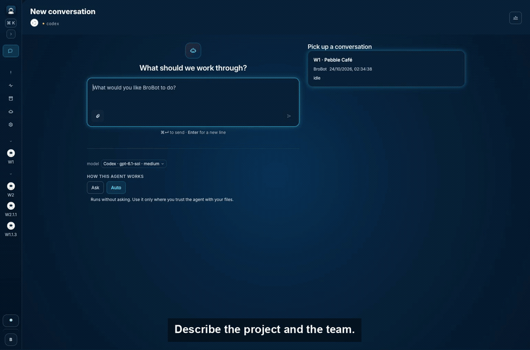
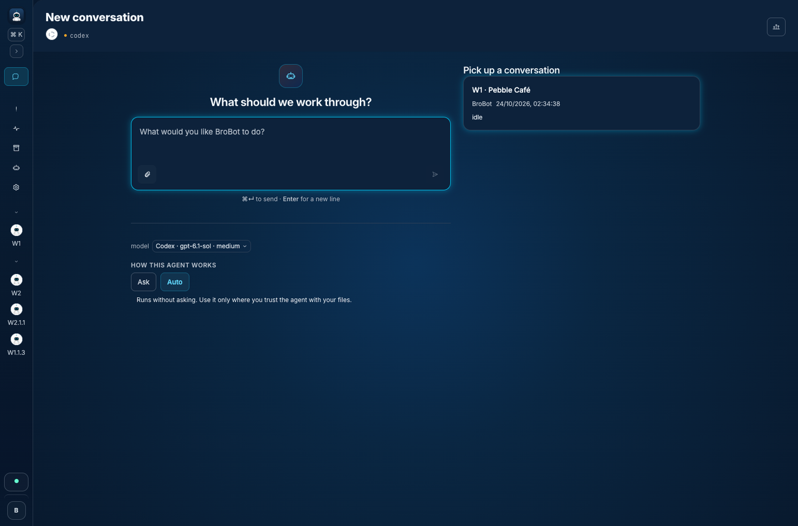
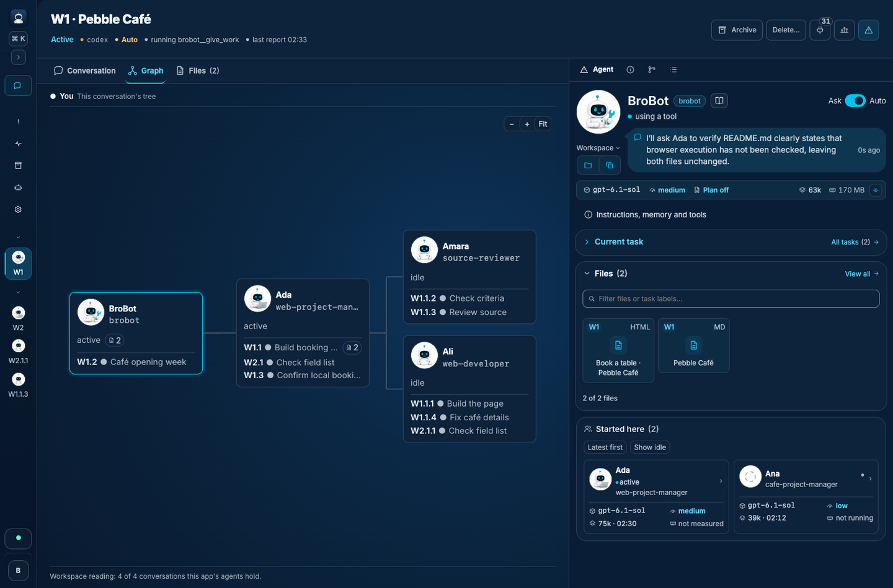
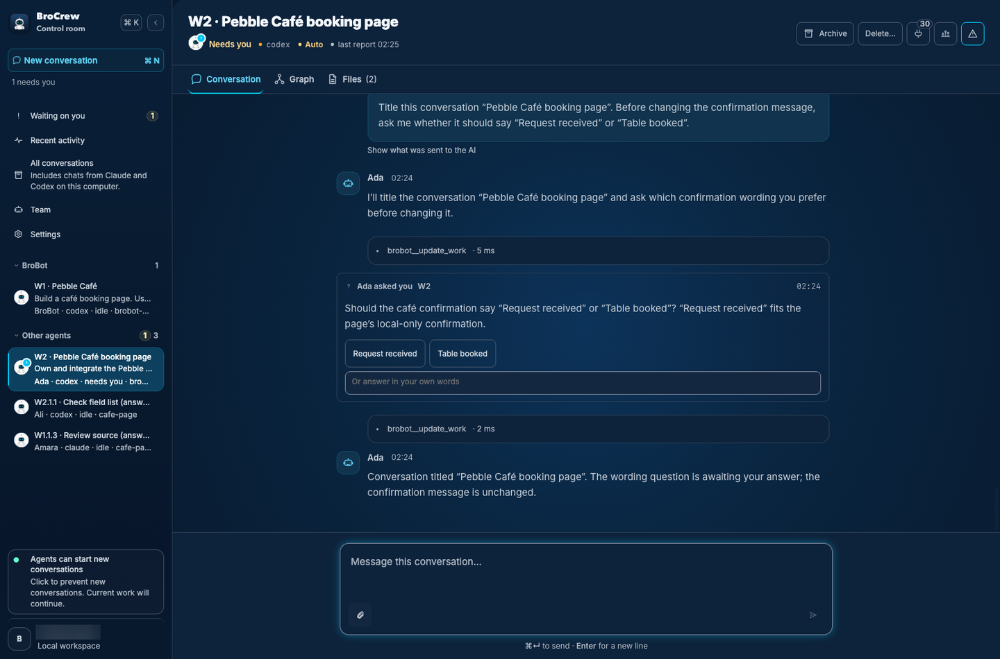
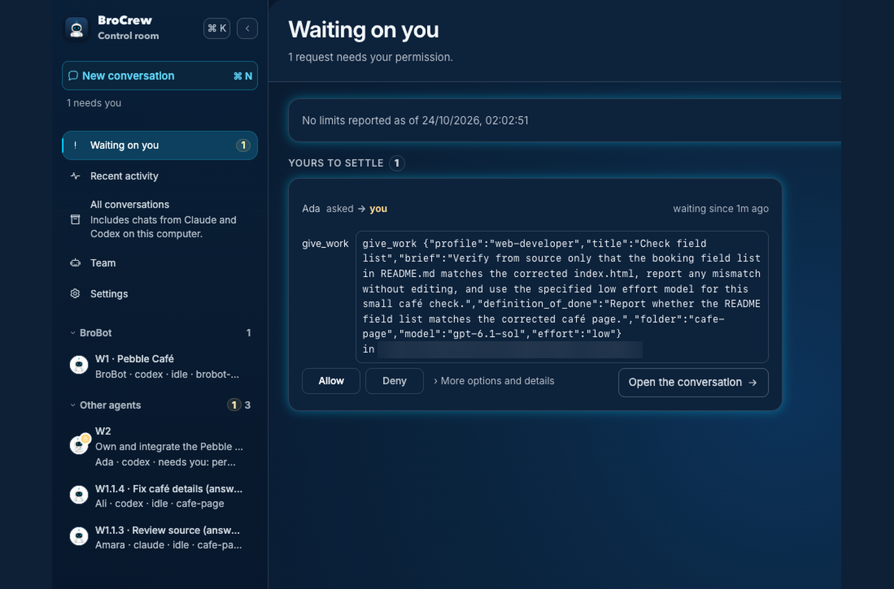
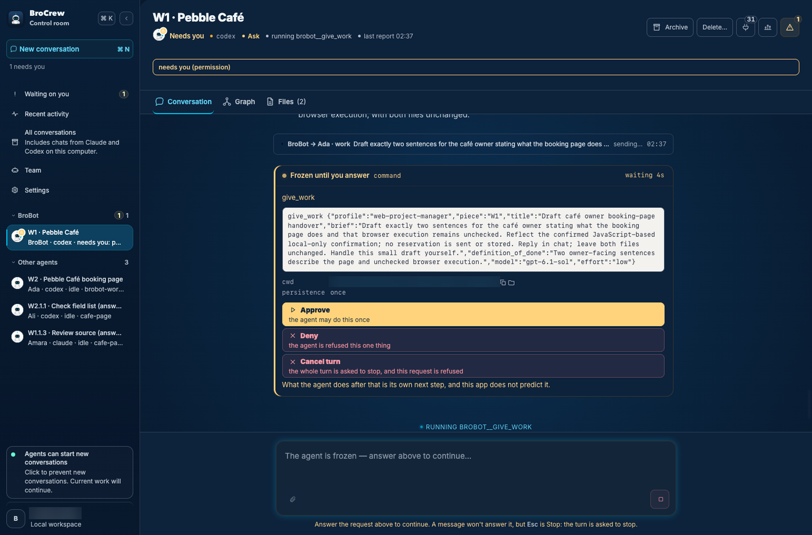
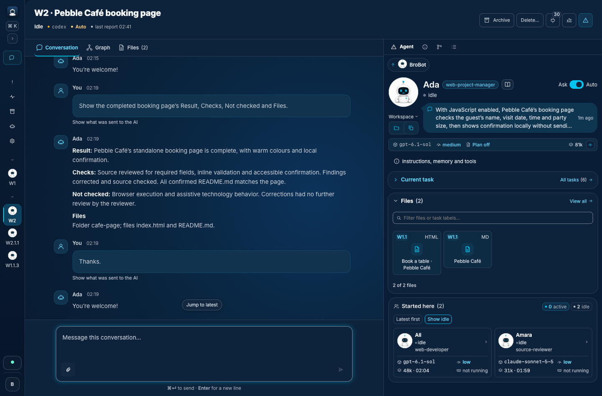
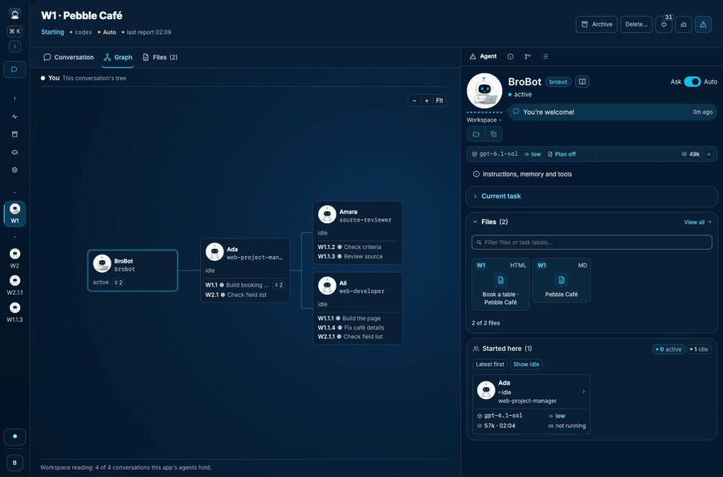

# BroCrew

**Give one agent a project. Follow the team's work in one tree, answer requests in one queue, and get a report back.**

  

**[Download](https://github.com/brocrew/brocrew/releases/latest)** · [Install guide](#install) · [Run from source](docs/run-from-source.md)

BroCrew is an open-source desktop app that brings AI agents together on your computer. Give an agent a task and it can share the work with other agents, Claude and Codex in the same tree. Each agent keeps its own memory and rules across conversations. Use your own Anthropic or OpenAI API key, and the provider bills your usage ([requirements and cost](docs/requirements-and-cost.md)).

Additional providers are planned.

## What's new in 0.1.8

0.1.8 focuses on plugins. Removing one plugin no longer makes the others unavailable, and the plugin service gets more time to start on a slow or just-started Mac. Plugins are new and still early, so tell us if one misbehaves. [Release notes and downloads](https://github.com/brocrew/brocrew/releases/tag/v0.1.8).

## See it work

**1. Describe the project and the team.** Type what you want, and how you'd like the team set up.

**2. Follow agents as they hand work to each other.** Every request is a piece of work with an owner. The Graph draws the tree as it grows, and the panel on the right shows each agent's model, files and the agents it started.

**3. Answer questions and review approval requests in one place.** Questions from agents appear in the conversation, and everything that needs you waits under **Waiting on you**.

Approval behaviour depends on the provider. In Ask mode, Claude asks when its permission system requires approval, and Codex can run commands inside its own sandbox without asking. When approval is needed, you see the request and its exact action before it runs. See [Safety](docs/safety.md).

**4. Read the result.** A finished piece of work comes back with its outcome, what was checked, what wasn't, and where the files are.

## Not just code

Ask for any kind of project in the same conversation. You can ask for a manager and a crew for each new project, and the Graph grows as they are recruited, with Claude and Codex agents side by side.

## Install

Get the latest build from the [Releases page](https://github.com/brocrew/brocrew/releases/latest):

| Your computer                        | File                              |
| ------------------------------------ | --------------------------------- |
| Mac with Apple Silicon (M1 or later) | `BroCrew-<version>-arm64.dmg`     |
| Windows 10 or 11, 64-bit (beta)      | `BroCrew-Setup-<version>-x64.exe` |

The Mac download isn't notarized, and the Windows download isn't signed, so your computer will warn you the first time. Follow the [Mac install guide](docs/install-macos.md) or [Windows install guide](docs/install-windows.md) to open the app.

Prefer the terminal? [Run from source](docs/run-from-source.md).

## First steps

- For Claude in the downloaded app, install [Claude Code first](docs/first-steps.md). Codex is included.
- Open **Settings → Providers** and connect Claude or Codex with an API key. See [setup help](docs/first-steps.md).
- Choose **New conversation**, pick a model and type what you want done.

## Learn more

- [How it works](docs/how-it-works.md)
- [Plugins](docs/plugins.md)
- [Safety](docs/safety.md)
- [Requirements and cost](docs/requirements-and-cost.md)
- [Providers](docs/providers.md)
- [Updates](docs/updates.md)
- [Data folder](docs/data-folder.md)
- [Contributing](docs/development.md#contributing)

## License

BroCrew is licensed under [Apache-2.0](LICENSE).
