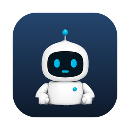
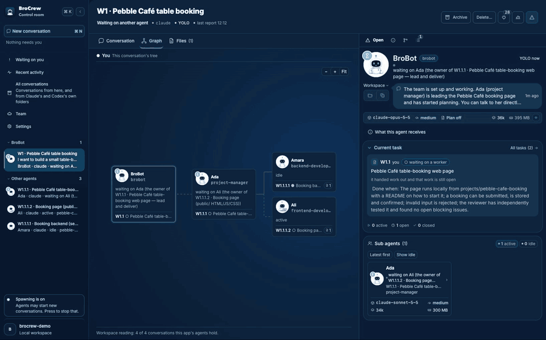
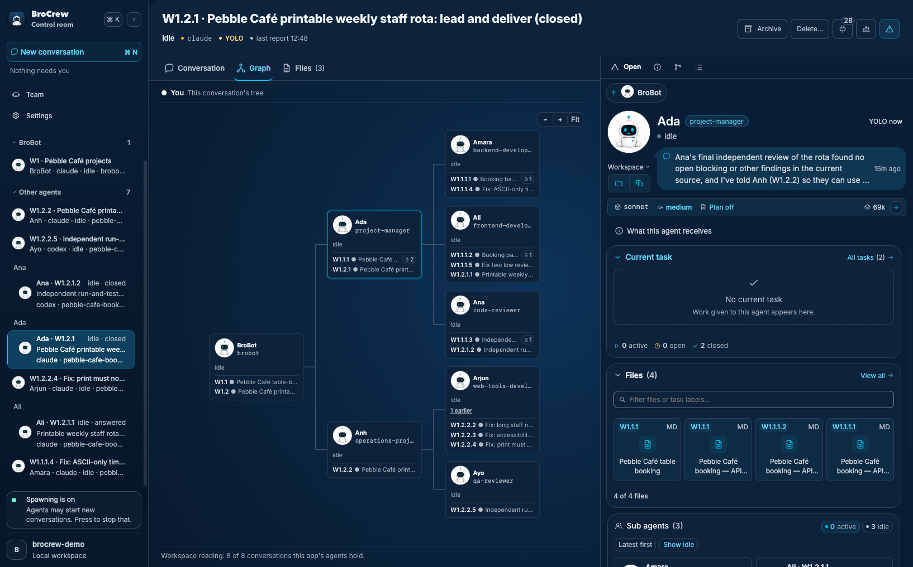
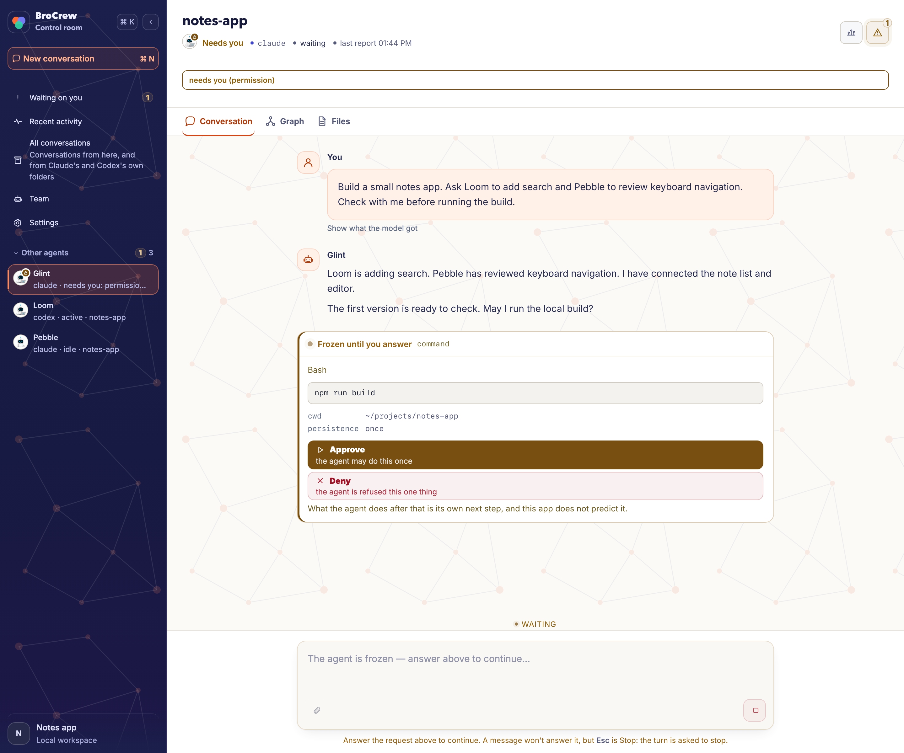
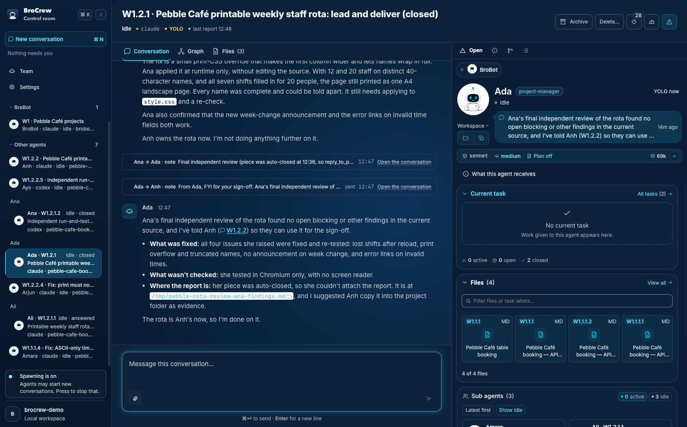

# BroCrew

**An open-source desktop app where AI agents hand work to each other — and you decide how much they do on their own.**

  

## What it is

BroCrew brings AI agents together on your computer.
Give an agent a task, and it can share the work with other agents.
Each agent keeps its own memory and rules across conversations.
Use it for coding, writing, research or other projects, with your own Anthropic or OpenAI API key.

## See it work

**One request becomes a tree of work.** You ask BroBot, the first agent, for two projects. It starts a project manager for each, and they bring in developers and reviewers. Every box is an agent and every line is work handed down. Claude and Codex agents sit in the same tree.

**You decide how far they go.** In the default "ask" mode, an agent stops and asks before it runs a command or changes a file. Everything that needs you waits in one list, **Waiting on you**.

**Work comes back with a result.** When a piece of work is finished, its owner reports what was fixed, what wasn't checked, and where the files are.

## Why BroCrew

- **You can see who is doing what.** Every request is a piece of work with an owner. Agents can hand pieces on to other agents, and the Graph draws the tree as it grows. An agent can run on Claude or on Codex, in the same tree.
- **You stay in charge.** Approvals, questions and stalled work all land in one place, so you don't hunt through tabs to find the agent that is waiting for you.
- **Agents that last.** Each agent keeps its own memory and standing rules, so it doesn't start from nothing every time you talk to it.

> In one real run, BroBot reported: "Chen (Claude) and Felix (Codex) each wrote their own audit, then checked the other's findings against the code, and Chen combined both into one report."

## Install

Get the latest build from the [Releases page](https://github.com/brocrew/brocrew/releases/latest):

| Your computer                        | File                              |
| ------------------------------------ | --------------------------------- |
| Mac with Apple Silicon (M1 or later) | `BroCrew-<version>-arm64.dmg`     |
| Windows 10 or 11, 64-bit (beta)      | `BroCrew-Setup-<version>-x64.exe` |

The downloads aren't signed yet, so your computer will warn you the first time. Follow the [Mac install guide](docs/install-macos.md) or [Windows install guide](docs/install-windows.md) to open the app.

Prefer the terminal? [Run from source](docs/run-from-source.md).

## First steps

- For Claude in the downloaded app, install [Claude Code first](docs/first-steps.md). Codex is included.
- Open **Settings → Providers** and connect Claude or Codex with an API key. See [setup help](docs/first-steps.md).
- Choose **New conversation**, pick a model and type what you want done.

## Learn more

- [How it works](docs/how-it-works.md)
- [Plugins](docs/plugins.md)
- [Safety](docs/safety.md)
- [Requirements and cost](docs/requirements-and-cost.md)
- [Providers](docs/providers.md)
- [Updates](docs/updates.md)
- [Data folder](docs/data-folder.md)
- [Contributing](docs/development.md#contributing)

## License

BroCrew is licensed under [Apache-2.0](LICENSE).
